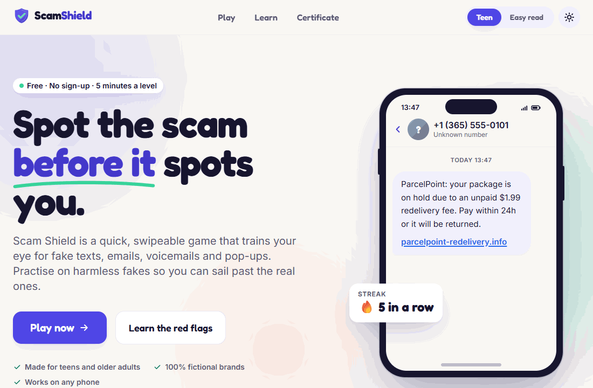

<p align="center">
  
</p>

<h1 align="center">Scam Shield</h1>
<p align="center"><strong>Spot the scam before it spots you.</strong><br/>A swipe-to-learn game that teaches teens and older adults to recognize scam texts, emails, voicemails and pop-ups.</p>

---

## The problem

In 2025, Canadians reported **more than $704 million** in fraud losses to the Canadian Anti-Fraud Centre, across more than 112,000 reports. That is the highest total on record, up from $638 million in 2024. The CAFC estimates that **only 5 to 10% of fraud is ever reported**, so the real cost is far higher.
<sub>Source: [Canadian Anti-Fraud Centre, *Fraud Prevention Month to bring hidden crime into the spotlight* (March 2026)](https://antifraudcentre-centreantifraude.ca/news-nouvelles/2026/2026-03-06-eng.htm)</sub>

Most of these scams don't rely on clever hacking. They use the same few psychological tricks over and over: fake urgency, a lookalike link, a "prize", a request for gift cards, a stranger pretending to be family. Pamphlets and warning posters don't build the reflex to notice those tricks in the moment. Practice does.

## Who it's for

- **Teens** who live on their phones and get targeted through game accounts, social DMs, hacked friends, fake job offers and "creator program" cons.
- **Older adults**, who are often targeted by grandparent scams, fake tax-agency calls and tech-support pop-ups. **Easy read** mode gives them larger text, simpler wording and slower voicemail playback.
- **Families, teachers and community groups** who want a five-minute activity that starts a conversation.

## Features

- 📱 **A realistic phone** receives messages one at a time: SMS, email, **voicemail with text-to-speech** (plus transcript), and browser or system pop-ups.
- 👆 **Swipe right to trust, left to report.** Cards use spring physics; the buttons and the ← → arrow keys do the same thing.
- 🚩 **Every red flag is highlighted on the message itself** and numbered: urgency, odd sender, mismatched link (with the real destination revealed), gift-card requests and more. Legit messages show their **green flags** too, because learning to trust real messages matters as well.
- 🎚️ **5 levels** that get harder: *The Obvious Ones → Links & Lookalikes → Calls & Pop-ups → Smooth Talkers → Master Class*. Pass with 70% to unlock the next.
- 🏆 **Scam-proof score** (0 to 100, weighted toward harder levels), streak bonuses, star ratings and **8 badges** such as *Link Detective*, *Voice Vigilante* and *Gift Card Guardian*.
- 👵🧑 **Teen / Easy read toggle**: different message decks per audience, simpler explanations, about 19% larger type throughout, and slower speech.
- 📚 **Learn page** covering the six most common scam patterns, a 5-second checklist, and what to do if you've been scammed.
- 🎓 **Shareable certificate** drawn on canvas, downloadable as a PNG, and shareable through the Web Share API on phones.
- 🌗 **Dark mode**, fully responsive, and accessibility built in: WCAG AA colour tokens, keyboard play, focus management, screen-reader labels, and `prefers-reduced-motion` support (no confetti, no shake, no fling).
- 🔒 **No accounts, no tracking.** Progress lives in `localStorage`. Every company, bank, app and domain is **fictional**, and phone numbers use the reserved 555 range.

## Tech stack

| | |
|---|---|
| UI | React 18 + TypeScript, Vite 5 |
| Styling | Tailwind CSS 3 driven by CSS-variable design tokens (light and dark) |
| Motion | Framer Motion (drag physics, springs, layout), canvas-confetti |
| State | Zustand with `persist` middleware |
| Routing | React Router 6 (lazy-loaded pages with skeleton fallbacks) |
| Audio | Web Speech API (`speechSynthesis`) |
| Tests | Vitest |
| CI / Deploy | GitHub Actions, Vercel |

## How it works

```
src/
├─ data/
│  ├─ messages.ts     # 41 messages. Each body is a list of segments; risky phrases carry a `flag`, safe ones a `good`
│  └─ flags.ts        # Red/green flag catalog with teen + easy-read explanations, and the Learn-page patterns
├─ lib/               # Pure, framework-free game logic (fully unit-tested)
│  ├─ scoring.ts      # points, streak bonus, level multiplier, stars, pass threshold, scam-proof score, ranks
│  ├─ levels.ts       # level definitions, unlock rules, seeded shuffle, per-audience decks
│  ├─ session.ts      # immutable session reducer: answer() / advance() / summarize()
│  ├─ badges.ts       # lifetime stats and badge rules
│  ├─ marks.ts        # numbers every flag in reading order so the phone and the explanation list match
│  └─ certificate.ts  # draws the certificate on <canvas>
├─ store/gameStore.ts # Zustand store wiring the pure logic to the UI, persisted to localStorage
├─ components/        # Phone, MessageView (sms/email/voicemail/popup), SwipeCard, badges, toggles…
└─ pages/             # Landing, Play (level select), Game, Learn, Certificate
```

**Annotating messages.** A message isn't stored as a plain string. It's a list of segments such as
`"Your package is on hold due to an "`, `{ t: "unpaid $1.99 fee", flag: "odd-payment", note: "…" }`.
Before you answer it renders as normal text. After you answer, the same segments are rendered with highlights and numbered markers, and `collectMarks()` produces the explanation list in the same order. Links store both the label you see and the URL they really open, so the reveal can show *"Actually opens: parcelpoint-redelivery.info"*.

**Scoring.** A correct answer is worth `(100 + streak bonus) × level multiplier`. The streak bonus is +25 per consecutive correct answer (capped at +100), and the multiplier runs from 1× on level 1 to 2× on level 5. Wrong answers score 0; we never take points away. The scam-proof score is your best accuracy on each level, weighted by difficulty, so you can only reach 100 by mastering every level.

## Getting started

```bash
npm install
npm run dev        # http://localhost:5178
npm test           # Vitest: scoring, levels, sessions, badges, content integrity
npm run build      # type-check + production build
```

Regenerate the brand images or this README's GIF (requires Chrome or Edge installed locally):

```bash
npm run assets     # public/og-image.png, favicon-32.png, apple-touch-icon.png
npm run dev & npm run hero-gif   # docs/hero.gif
```

## Deploy

The repo is ready for Vercel with zero configuration. Import it, and `vercel.json` handles the build plus SPA rewrites. CI runs the type check, tests and build on every push and pull request.

## Adding a message

Add an entry to `src/data/messages.ts`, keeping all brands fictional. The tests make sure every scam has at least one red flag, every legit message has at least one green flag, IDs are unique, and every level still has a balanced deck for both audiences.

---

<sub>Scam Shield is an educational project. All organizations depicted are fictional. If you've received a suspicious message or lost money, contact your bank and the Canadian Anti-Fraud Centre at 1-888-495-8501.</sub>
